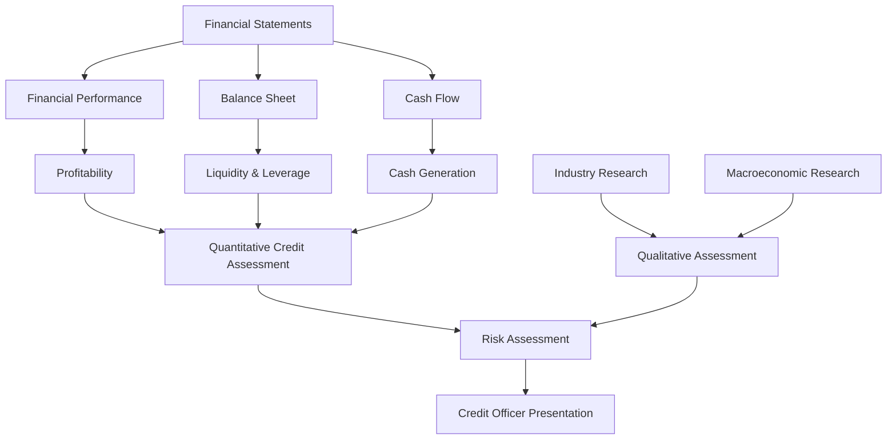
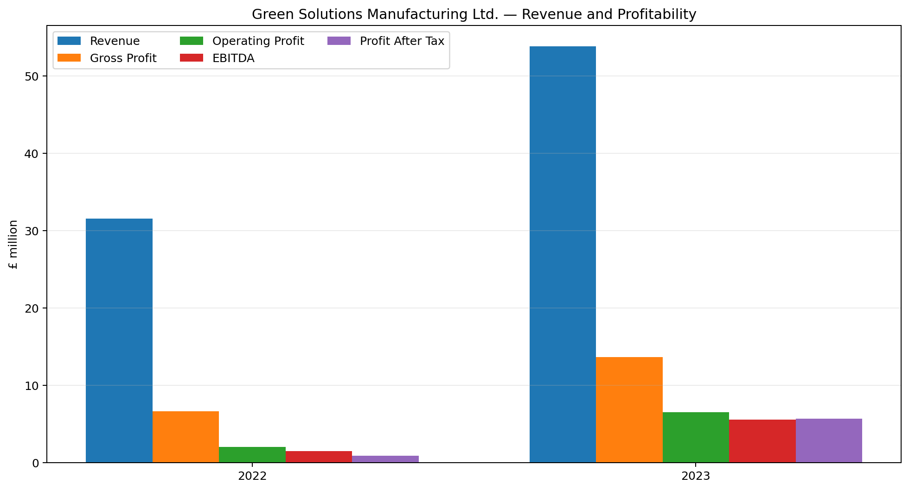
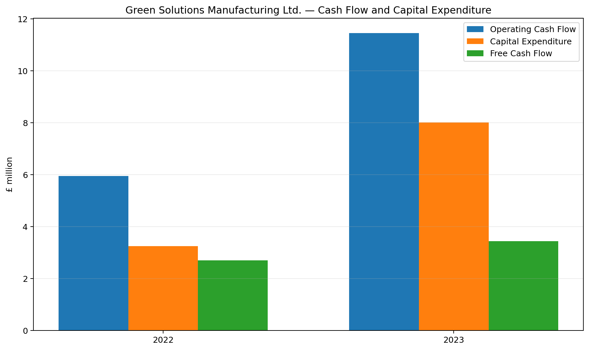
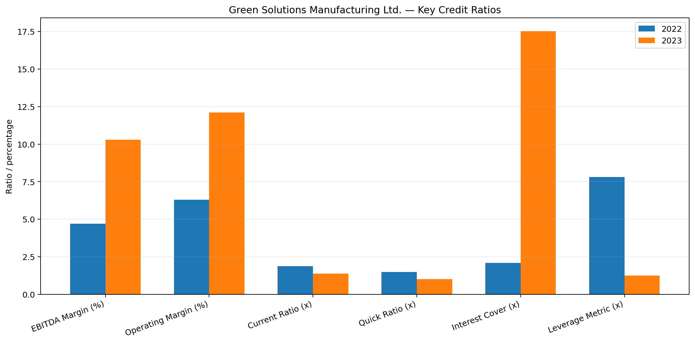

# Green-Solutions_Financial-Health-Analysis

# Standard Chartered — Credit Analyst Job Simulation

## Annual Credit Review of Green Solutions Manufacturing Ltd.


.

> **A quantitative and qualitative credit assessment conducted as part of the Standard Chartered Banking & Coverage Job Simulation on Forage.**

---

## 📌 Project Overview

This project was completed as part of the **Standard Chartered Banking and Coverage Job Simulation on Forage**, where I worked through a simulated **Credit Analyst** assignment involving the annual credit review of **Green Solutions Manufacturing Ltd.**

Green Solutions Manufacturing Ltd. is a hypothetical sustainable drinkware manufacturer seeking additional credit to support further sustainability initiatives.

The project required an assessment of the company's:

* Financial performance
* Profitability
* Liquidity
* Leverage
* Interest coverage
* Cash-flow generation
* Capital expenditure
* Balance-sheet position
* Industry outlook
* Market opportunities and risks
* Key credit risks
* Ability to support additional borrowing

The analysis combined **quantitative financial analysis** with **qualitative industry and macroeconomic research** before communicating the findings in a professional credit-officer presentation.

---

## 🎯 Project Objectives

The main objectives of the credit review were to:

1. Assess the company's financial health.
2. Analyse changes in revenue and profitability.
3. Evaluate the company's assets, liabilities and equity.
4. Assess operating cash-flow generation.
5. Evaluate liquidity and leverage.
6. Assess the company's ability to service interest obligations.
7. Analyse capital expenditure and free cash flow.
8. Identify emerging financial risks.
9. Research the sustainable drinkware industry.
10. Assess relevant market opportunities and challenges.
11. Consider macroeconomic factors affecting the business.
12. Present the findings clearly to a credit officer.

---

# 🏢 Case Background

### Client

**Green Solutions Manufacturing Ltd.**

### Industry

**Sustainable drinkware manufacturing**

### Products

The company operates in the reusable drinkware market, including products such as:

* Reusable water bottles
* Reusable coffee cups
* Other sustainable drinkware products

### Credit Context

The company is an established client seeking additional borrowing to support further investment in sustainability initiatives.

A key component of the assessment was therefore understanding the relationship between:

```text
Sustainability Investment
        ↓
Capital Expenditure
        ↓
Cash-Flow Requirements
        ↓
Borrowing
        ↓
Leverage & Interest Burden
        ↓
Debt-Service Capacity
```

The objective was not simply to determine whether the company was profitable, but to understand whether its financial position and cash-generating capacity could support continued investment and additional credit.

---

# 🔍 Analytical Approach

The project used two complementary areas of analysis.

## 1. Quantitative Credit Analysis

The financial analysis covered:

| Area              | Analysis Performed                            |
| ----------------- | --------------------------------------------- |
| Revenue           | Revenue growth and trend analysis             |
| Cost of Sales     | Cost growth relative to revenue               |
| Gross Profit      | Gross-profit growth and margin                |
| Operating Profit  | Operating performance                         |
| EBITDA            | Earnings and operating cash-generation proxy  |
| Net Profit        | Bottom-line profitability                     |
| Assets            | Asset growth and composition                  |
| Liabilities       | Short- and long-term obligations              |
| Equity            | Net worth and capital position                |
| Cash Flow         | Operating, investing and financing cash flows |
| CapEx             | Capital investment requirements               |
| Free Cash Flow    | CFO less CapEx                                |
| Liquidity         | Current and quick ratios                      |
| Leverage          | Debt relative to profitability                |
| Interest Coverage | Ability to service interest                   |
| Risk              | Identification of financial pressure points   |

---

## 2. Qualitative Credit Analysis

The quantitative assessment was complemented with research into:

* Sustainable drinkware market growth
* Reusable coffee-cup market
* Reusable water-bottle market
* Environmental trends
* Restrictions on single-use plastics
* Consumer behaviour
* Product innovation
* Competitive pressures
* Price sensitivity
* Inventory and product-obsolescence risk
* Macroeconomic conditions
* Interest-rate environment

This helped place the company's financial performance within the broader industry and economic environment.

---

# 📊 Financial Performance — 2022 vs 2023

All financial figures below are presented in **£'000**.Revenue increased from £31.536 million to £53.823 million, representing approximately 70.7% growth. Earnings Before Interest, Taxes, Depreciation and Amortisation (EBITDA) increased from £1.494 million to £5.523 million, while Profit After Tax (PAT) increased from £0.862 million to £5.644 million.

| Metric              |     2022 |     2023 |      Change |
| ------------------- | -------: | -------: | ----------: |
| Revenue             | £31,536K | £53,823K |  **+70.7%** |
| Cost of Sales       | £24,906K | £40,217K |  **+61.5%** |
| Gross Profit        |  £6,630K | £13,606K | **+105.2%** |
| Operating Profit    |  £1,994K |  £6,523K | **+227.1%** |
| EBITDA              |  £1,494K |  £5,523K | **+269.8%** |
| Profit Before Tax   |  £1,154K |  £6,343K | **+449.6%** |
| Profit After Tax    |    £862K |  £5,644K | **+554.8%** |
| Total Assets        | £52,148K | £62,131K |  **+19.2%** |
| Total Liabilities   | £28,418K | £30,548K |   **+7.5%** |
| Total Equity        | £23,075K | £31,015K |  **+34.4%** |
| Operating Cash Flow |  £5,943K | £11,446K |  **+92.6%** |
| CapEx               |  £3,242K |  £8,014K | **+147.2%** |
| Free Cash Flow      |  £2,701K |  £3,432K |  **+27.1%** |

### Key observation

Revenue increased substantially between 2022 and 2023, while cost of sales grew at a slower rate.

This contributed to a significant improvement in gross profit, operating profit, EBITDA and net income.

At the same time, the company significantly increased its capital investment, making cash-flow analysis particularly important to the credit assessment.

---

# 📈 Revenue & Profitability

## Revenue

Revenue increased from:

**£31.536 million → £53.823 million**

This represents approximately **70.7% growth**.

The fact that revenue growth exceeded the growth in cost of sales contributed to an improvement in gross profitability.

---

## Gross Profit

Gross profit increased from:

**£6.630 million → £13.606 million**

This represents approximately **105.2% growth**.

Gross margin also improved:

```text
2022: 21.0%
2023: 25.3%
```

This indicates that the company generated substantially more gross profit from each pound of revenue in 2023.

---

## Operating Profit

Operating profit increased from:

**£1.994 million → £6.523 million**

Approximately:

**+227.1%**

Operating margin increased from approximately:

```text
2022: 6.3%
2023: 12.1%
```

This indicates significant improvement in operating profitability.

---

## EBITDA

EBITDA increased from:

**£1.494 million → £5.523 million**

Approximately:

**+269.8%**

EBITDA margin increased from:

```text
2022: 4.7%
2023: 10.3%
```

This was one of the most significant improvements in the financial analysis.

---

# 💷 Profitability Trend

```text
                 2022              2023

Revenue          £31.5m   ───────► £53.8m
Gross Profit      £6.6m   ───────► £13.6m
EBITDA            £1.5m   ───────► £5.5m
Operating Profit  £2.0m   ───────► £6.5m
PAT               £0.9m   ───────► £5.6m
```

The improvement was particularly notable at the operating and bottom-line levels.

---

# 🏦 Assets, Liabilities & Equity

## Assets

Total assets increased from:

**£52.148 million → £62.131 million**

Approximately:

**+19.2%**

Non-current assets increased substantially, reflecting the company's significant investment programme.

Cash, however, decreased from:

**£19.384 million → £17.576 million**

This was an important consideration because strong profitability and operating cash generation were occurring alongside significant capital investment and financing activity.

---

## Liabilities

Total liabilities increased from:

**£28.418 million → £30.548 million**

Approximately:

**+7.5%**

The growth in liabilities was considerably lower than the growth in total assets and equity.

---

## Equity

Total equity increased from:

**£23.075 million → £31.015 million**

Approximately:

**+34.4%**

This represents a material strengthening in the company's reported equity position.

---

# 💰 Cash-Flow Analysis

Operating cash flow increased significantly:

**£5.943 million → £11.446 million**

Approximately:

**+92.6%**
Operating Cash Flow increased from £5.943 million to £11.446 million. Capital Expenditure (CapEx) increased from £3.242 million to £8.014 million. Using the project's methodology, Free Cash Flow (FCF) remained positive, increasing from £2.701 million to £3.432 million.
This was an important positive factor because credit analysis requires consideration of actual cash generation, not profitability alone.

---

## Capital Expenditure

Capital expenditure increased from:

**£3.242 million → £8.014 million**

Approximately:

**+147.2%**

This reflects the substantial investment programme undertaken by the company.

However, the increase in CapEx also creates an important credit-monitoring consideration because sustained high investment can place pressure on liquidity and future cash flows.

---

# ⚠️ Free Cash Flow — Important Methodology

For this project, Free Cash Flow was assessed using:

```text
Free Cash Flow = Operating Cash Flow − Capital Expenditure
```

Using the company's reported methodology:

|                     |        2022 |        2023 |
| ------------------- | ----------: | ----------: |
| Operating Cash Flow |     £5.943m |    £11.446m |
| Capital Expenditure |     £3.242m |     £8.014m |
| **Free Cash Flow**  | **£2.701m** | **£3.432m** |

Therefore, free cash flow remained **positive in both years**.

It increased by approximately **27.1%** from 2022 to 2023.

This is an important part of the credit assessment because operating cash generation covered the reported capital expenditure in both periods.

---

# 📐 Key Financial Ratios

| Ratio / Metric   |   2022 |   2023 | Interpretation                      |
| ---------------- | -----: | -----: | ----------------------------------- |
| EBITDA Margin    |   4.7% |  10.3% | Significant improvement             |
| Operating Margin |   6.3% |  12.1% | Significant improvement             |
| Interest Cover   |  2.08x | 17.53x | Material improvement                |
| Current Ratio    |  1.88x |  1.38x | Liquidity buffer reduced            |
| Quick Ratio      |  1.49x | ~1.00x | Short-term liquidity became tighter |
| Leverage Metric  |  7.82x |  1.24x | Significant reduction               |
| Net Leverage     | -5.15x | -1.94x | Changed materially                  |
| CF / CapEx       |  -1.83 |  -1.43 | Remains an area to monitor          |

> **Note:** Ratio calculations follow the definitions and methodology provided in the project's accounting-ratio workbook rather than replacing them with alternative industry definitions.

---

# 💪 Interest Coverage

Interest cover improved substantially:

```text
2022: 2.08x
2023: 17.53x
```

This indicates that the company's earnings provided a much larger coverage buffer relative to interest obligations in 2023.

Net interest expense also declined from approximately:

**£718K → £315K**

This represents a reduction of approximately **56%** in the project's reported net interest expense.

---

# 💧 Liquidity

Liquidity requires closer monitoring despite the improvement in profitability.

### Current Ratio

```text
2022: 1.88x
2023: 1.38x
```

### Quick Ratio

```text
2022: 1.49x
2023: ~1.00x
```

Current liabilities increased considerably faster than current assets.

Therefore, while the company remained profitable and generated strong operating cash flow, the short-term liquidity buffer became narrower.

---

# ⚖️ Leverage

The workbook's leverage metric improved from:

```text
2022: 7.82x
2023: 1.24x
```

This represents a substantial reduction in leverage relative to profitability.

This improvement, combined with stronger EBITDA and interest coverage, was an important positive development in the credit assessment.

---

# 🔬 Industry Research

The company operates within markets benefiting from long-term interest in reusable and sustainable alternatives to single-use products.

## Reusable Coffee Cups

Research used during the project indicated:

* Global reusable coffee-cup market estimated at approximately **US$13 billion in 2019**
* Expected to approach **US$25 billion by 2031**
* Approximate CAGR of **5.8%**
* Europe represented the largest regional revenue share in 2019
* Europe was expected to grow at approximately **6.5% CAGR**
* Residential applications were expected to experience continued growth

---

## Reusable Water Bottles

Research used in the project indicated:

* Global market estimated at approximately **US$8.8 billion in 2024**
* Expected to exceed **US$11.5 billion by 2034**
* Approximate CAGR of **2.8%**
* China projected at approximately **4.7% CAGR**
* India projected at approximately **6.5% CAGR**
* United States projected at approximately **1.7% CAGR**

---

# 🌱 Industry Growth Drivers

Several factors support demand for reusable drinkware:

### Environmental Awareness

Increasing concern about plastic waste can encourage consumers and businesses to adopt reusable products.

### Regulation

Restrictions on certain single-use plastic products can create additional demand for reusable alternatives.

### Health & Wellness

Reusable bottles can benefit from consumer interest in hydration and healthier lifestyles.

### Tourism & Convenience

Portable reusable products can benefit from travel, commuting and outdoor activities.

### Product Innovation

Manufacturers are increasingly developing:

* Smart bottles
* Customised products
* Stainless-steel products
* Glass products
* Bamboo-based products
* Technology-enabled drinkware

---

# ⚠️ Industry Risks

The industry also faces several risks.

| Risk                             | Potential Credit Relevance                      |
| -------------------------------- | ----------------------------------------------- |
| Price sensitivity                | Could pressure margins                          |
| New market entrants              | Could increase competitive pressure             |
| Inventory requirements           | Could tie up working capital                    |
| Product innovation               | Could make existing inventory obsolete          |
| Consumer convenience             | Reusable products may face behavioural barriers |
| Mobile/drive-through consumption | Could reduce usage convenience                  |
| Sustainability investment        | May require continued high CapEx                |
| Economic conditions              | Could affect consumer spending                  |

---

# 🌍 Macroeconomic Considerations

The project also considered the broader economic environment, including:

* UK interest rates
* Inflation
* Economic growth
* Consumer spending
* Business investment conditions

Higher interest rates are particularly relevant to credit analysis because they can increase the cost of borrowing and affect debt-service capacity.

Therefore, the company's strong improvement in interest coverage was an important factor when assessing its financial position.

---

# 🚨 Key Credit Risks Identified

The analysis identified four major areas requiring continued monitoring.

## 1. Liquidity

Current and quick ratios declined between 2022 and 2023.

**Monitoring focus:**

* Cash balances
* Current liabilities
* Working-capital requirements
* Short-term debt obligations

---

## 2. Capital Expenditure

CapEx increased by approximately **147%**.

While operating cash flow remained sufficient to cover reported CapEx in the two years analysed, continued high investment could place pressure on future liquidity.

**Monitoring focus:**

* Future CapEx requirements
* Cash-flow forecasts
* Financing requirements
* Sustainability of operating cash generation

---

## 3. Inventory

Inventory increased from:

**£4.101 million → £5.757 million**

Approximately:

**+40.4%**

Inventory growth should be monitored to ensure that working capital does not become unnecessarily tied up and that product innovation does not create obsolescence risk.

---

## 4. Sustainability of Cash Generation

The company generated substantially stronger operating cash flow in 2023.

However, the credit assessment should continue monitoring whether this level of cash generation can be maintained while the company continues its significant investment programme.

---

# ✅ Positive Credit Indicators

The financial analysis identified several material improvements:

* Revenue increased by approximately **70.7%**
* Gross profit increased by approximately **105.2%**
* Operating profit increased by approximately **227.1%**
* EBITDA increased by approximately **269.8%**
* Profit after tax increased by approximately **554.8%**
* EBITDA margin more than doubled
* Operating margin approximately doubled
* Operating cash flow increased by approximately **92.6%**
* Free cash flow remained positive
* Interest coverage improved from **2.08x to 17.53x**
* Leverage metric reduced from **7.82x to 1.24x**
* Equity increased by approximately **34.4%**
* Total liabilities increased at a slower rate than total assets

---

# 🧭 Credit Assessment Framework

The overall assessment followed this framework:



---

# 📋 Overall Assessment

The analysis indicates that Green Solutions Manufacturing Ltd. experienced a **material strengthening of financial performance between 2022 and 2023**.

The strongest improvements were observed in:

* Revenue
* Gross profit
* Operating profit
* EBITDA
* Net income
* Operating cash flow
* Interest coverage
* Leverage
* Equity

At the same time, several areas require continued monitoring:

* Liquidity
* Inventory
* Capital expenditure
* Cash balance
* Sustainability of cash generation
* Future financing requirements

The sustainable drinkware industry also presented long-term growth drivers associated with environmental awareness, reusable-product adoption, regulation and product innovation.

---

# 🎯 Credit Consideration

Based on the financial and industry analysis, the evidence supports **continued consideration of additional credit**, subject to further review of:

* Proposed facility terms
* Detailed cash-flow forecasts
* Debt-service requirements
* Collateral
* Credit history
* Future capital expenditure
* Liquidity requirements
* Sustainability of operating cash generation

The analysis therefore combines positive financial developments with clearly identified monitoring requirements rather than treating any single financial metric as sufficient for a credit decision.

---

# 🧠 Key Lessons From the Project

This simulation strengthened my understanding that credit analysis is more than calculating financial ratios.

A proper credit assessment requires connecting the numbers to the underlying business.

For example:

```text
Revenue Growth
      ↓
Higher Gross Profit
      ↓
Higher Operating Profit / EBITDA
      ↓
Stronger Cash Generation
      ↓
Improved Interest Coverage
      ↓
Lower Relative Leverage
```

But simultaneously:

```text
Higher Sustainability Investment
      ↓
Higher Capital Expenditure
      ↓
Greater Cash Requirements
      ↓
Potential Liquidity Pressure
      ↓
Need for Continued Cash-Flow Monitoring
```

The project therefore demonstrated the importance of considering **both financial strength and financial risk**.

---

# 🛠️ Tools & Skills Demonstrated

## Tools

* Microsoft Excel
* Microsoft Word
* Financial modelling
* Financial ratio analysis
* Data interpretation
* Industry research
* Presentation development

## Analytical Skills

* Financial statement analysis
* Credit analysis
* Quantitative analysis
* Ratio analysis
* Cash-flow analysis
* Risk identification
* Industry research
* Critical thinking
* Business analysis
* Financial interpretation

## Communication Skills

* Executive-level summarisation
* Credit-report writing
* Presentation of financial findings
* Communicating risks and actionable insights
* Translating financial data into business implications

---

# 📁 Repository Structure

```text
standard-chartered-credit-analysis/
│
├── README.md
├── Financial_Analysis.xlsx
├── Preliminary_Credit_Report.pdf
├── Credit_Officer_Presentation.pdf
├── Industry_Research.md
└── images/
    ├── financial_performance.png
    ├── cash_flow.png
    └── financial_ratios.png
```

---

# 📄 Project Deliverables

The repository should ideally contain the following deliverables:

| Deliverable                       | Purpose                                   |
| --------------------------------- | ----------------------------------------- |
| `README.md`                       | Project overview and case study           |
| `Financial_Analysis.xlsx`         | Financial calculations and ratio analysis |
| `Preliminary_Credit_Report.pdf`   | Written credit assessment                 |
| `Credit_Officer_Presentation.pdf` | Executive presentation                    |
| `Industry_Research.md`            | Supporting industry research              |
| `images/`                         | Visualisations used in README             |

---

# 📊 Recommended GitHub Visuals

The README should not depend entirely on paragraphs.

I recommend adding **3–4 original charts** created from the financial data.

### Visual 1 — Revenue & Profitability

A grouped bar chart comparing:

* Revenue
* Gross Profit
* EBITDA
* Operating Profit
* Profit After Tax

for 2022 vs 2023.
## Revenue and Profitability



Revenue increased by approximately 70.7% between 2022 and 2023, while gross profit, operating profit, EBITDA and profit after tax increased at substantially higher rates.

### Visual 2 — Cash Flow

A chart showing:

* Operating Cash Flow
* CapEx
* Free Cash Flow

for 2022 and 2023.
## Cash Flow and Capital Expenditure



Operating cash flow increased by approximately 92.6%, while capital expenditure increased by approximately 147.2%. Free cash flow remained positive in both years, increasing from £2.701 million to £3.432 million.

### Visual 3 — Credit Ratios

A chart showing:

* Current Ratio
* Quick Ratio
* Interest Cover
* Leverage Metric

## Key Credit Ratios



The analysis shows significant improvement in profitability margins, interest coverage and the project's leverage metric, while current and quick liquidity ratios declined.

> **Note:** Percentage-based measures such as Earnings Before Interest, Taxes, 
> Depreciation and Amortisation (EBITDA) margin and Operating Margin are shown 
> alongside ratio-based measures such as Interest Cover and the Leverage Metric. 
> The chart is intended to highlight year-on-year movement; the underlying 
> values and definitions are provided in the financial analysis workbook.

### Visual 4 — Credit Risk Framework

A simple diagram showing:

```text
Financial Performance
        +
Liquidity
        +
Leverage
        +
Cash Flow
        +
Industry
        +
Macroeconomics
        ↓
Credit Risk Assessment
```


---

# 🧾 Methodology Note

The financial analysis follows the accounting and ratio definitions provided within the Standard Chartered simulation materials.

For example:

### Current Ratio

```text
Current Ratio = Current Assets / Current Liabilities
```

### Quick Ratio

```text
Quick Ratio =
(Current Assets − Inventory − Prepaid Expenses)
÷ Current Liabilities
```

### Interest Cover

Interest coverage was assessed using the methodology provided in the project workbook.

### Leverage

The project's leverage metric uses debt relative to profitability, with lower leverage interpreted as more favourable within the workbook's methodology.

The project therefore preserves the simulation's methodology rather than imposing unrelated alternative definitions.

---

# ⚠️ Important Disclaimer

This repository documents a **virtual job simulation completed through Forage**.

Green Solutions Manufacturing Ltd. is a **hypothetical company used for the simulation** and is not presented as a real client of mine.

The financial information, analysis and credit assessment were produced for educational and professional-development purposes.

The analysis should not be interpreted as actual investment, lending or financial advice.

---

# 🏆 Simulation Result

**Standard Chartered Banking & Coverage Job Simulation — Forage**

| Result            |               Outcome |
| ----------------- | --------------------: |
| Overall Score     |              **100%** |
| Questions Correct |           **10 / 10** |
| Role              |    **Credit Analyst** |
| Completed         | **23 September 2026** |

### Skills assessed

* Accounting Fundamentals
* Credit Analysis
* Critical Thinking
* Presentation Skills
* Quantitative Analysis
* Research
* Risk Identification

---

# 📜 Certificate
[View Certificate](Green_Solutions/standard_chatered_completion_certificate.pdf)
The Standard Chartered Banking and Coverage Job Simulation was completed through **Forage** on **23 September 2026**.

---

# 💼 Professional Relevance

This project demonstrates practical exposure to a credit-analysis workflow, including:

```text
Financial Statements
        ↓
Financial Analysis
        ↓
Ratio Analysis
        ↓
Cash-Flow Assessment
        ↓
Industry Research
        ↓
Risk Identification
        ↓
Credit Assessment
        ↓
Executive Communication
```

The project is particularly relevant to roles involving:

* Credit Analysis
* Financial Analysis
* Risk Analysis
* Business Analysis
* Data Analysis
* Banking & Finance
* Corporate Finance
* Decision Analytics

---

# 👤 Author

**Ugochukwu Joshua Toluwaleke**

B.Sc. Mathematics
Federal University of Agriculture, Abeokuta

Areas of interest:

* Data Analytics
* Financial Analysis
* Business & Decision Analytics
* Python
* SQL
* Machine Learning
* Risk & Credit Analysis

---

## ⭐ Project Takeaway

The central lesson from this project was that effective credit analysis requires more than determining whether a company is profitable.

A strong assessment connects:

**profitability + cash generation + liquidity + leverage + debt-service capacity + investment requirements + industry conditions + risk**

to form a structured view of the company's financial position and its ability to support future obligations.

---
# Green-Solutions_Financial-Health-Analysis
